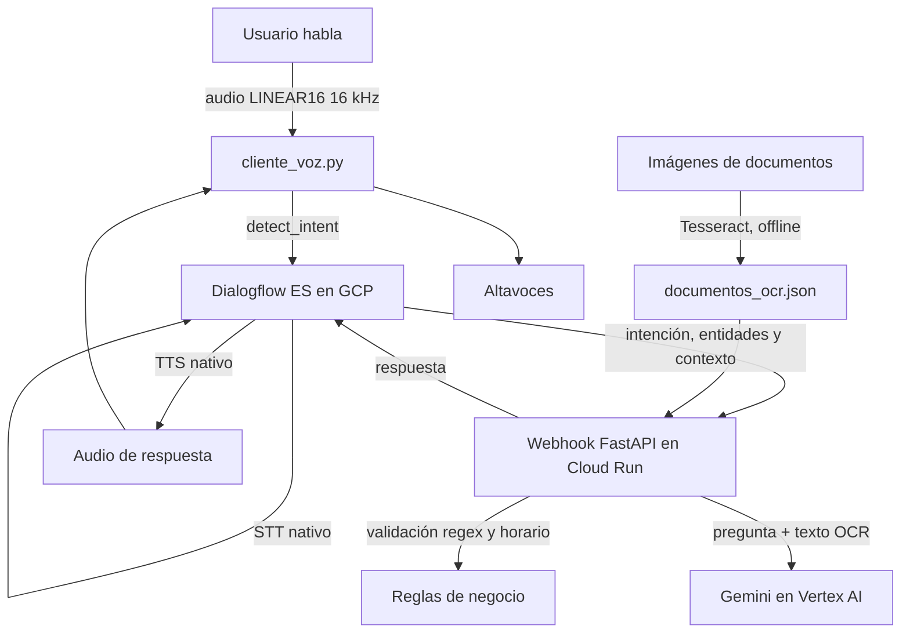

# Asistente de voz para una clínica veterinaria

Prototipo académico de una clínica ficticia, **Clínica Patitas**, para pedir una cita por voz o consultar información de sus documentos. Dialogflow ES en Google Cloud reconoce la intención y administra los turnos; en la solicitud de cita pide especie, nombre de la mascota, motivo, fecha, hora y teléfono, y solo envía la solicitud de demostración cuando la persona confirma con sí. Un webhook FastAPI valida los datos y consulta mediante Gemini en Vertex AI un conjunto pequeño de documentos procesados antes con OCR. Los horarios y servicios incluidos son datos ficticios de demostración, no información de una clínica real.

## Arquitectura



Flujo de cita: bienvenida → `solicitar_cita` (slot filling) → resumen → `confirmar_cita` (sí/no) → despedida.

## Intenciones

El agente contiene seis intenciones de negocio más la extra de transferencia, además de las intenciones de bienvenida y fallback:

| Intención | Propósito |
| --- | --- |
| `solicitar_cita` | Recoger tipo de mascota, nombre, motivo, fecha, hora y teléfono en el contexto de cita. |
| `confirmar_cita` | Confirmar o cancelar la solicitud pendiente mediante sí/no y el contexto de confirmación. |
| `cancelar_cita` | Descartar una solicitud de cita pendiente. |
| `consultar_horarios` | Responder preguntas de horarios a partir de los documentos OCR. |
| `consultar_servicios` | Responder preguntas de los servicios descritos en los documentos OCR. |
| `consultar_documentos` | Consultar información general de los documentos, por ejemplo cómo preparar una visita. |
| `transferir_humano` | **Extra.** Ante una urgencia o petición de hablar con una persona, cancela la cita en curso y transfiere a un operador (simulado; el cliente de voz termina la sesión). |
| `Default Welcome Intent` | Saludar cordialmente y preguntar si la mascota es perro, gato u otra. |
| `Default Fallback Intent` | Con el webhook activo, intenta responder desde los documentos; si el dato no consta, lo indica sin inventar. |

`tipo_mascota` es una entidad personalizada; `telefono` es una entidad regex que restringe el contacto a móviles españoles. El flujo de cita requiere todos sus parámetros y termina en `confirmar_cita`. La solicitud y el identificador de confirmación se guardan solo en memoria durante un máximo de 15 minutos; no es una agenda real ni conserva datos después de reiniciar el proceso.

## Requisitos previos

- Python 3.10 o posterior.
- Tesseract OCR instalado en el sistema **con el idioma español (`spa`)**.
- Una cuenta/proyecto de Google Cloud con Dialogflow ES y Vertex AI habilitados.
- `gcloud` CLI para las credenciales locales del cliente de voz (el despliegue se hace desde Cloud Shell).
- Micrófono y altavoces para ejecutar el cliente de voz.

En Ubuntu/Debian, se puede instalar Tesseract con:

```bash
sudo apt-get update
sudo apt-get install tesseract-ocr tesseract-ocr-spa
```

En Windows, instala Tesseract y el paquete de idioma español, y configura `TESSERACT_CMD` en `.env` si no está en `PATH`.

## Instalación y OCR local

Desde esta carpeta, crea un entorno aislado e instala los paquetes Python:

```bash
python -m venv .venv
source .venv/bin/activate          # Windows: .venv\Scripts\activate
python -m pip install --upgrade pip
pip install -r requirements.txt
cp .env.example .env               # Windows: copia manualmente el archivo
```

No se guardan credenciales en `.env.example`. Edita `.env` y añade el ID de tu proyecto de Google Cloud:

```dotenv
GOOGLE_CLOUD_PROJECT=tu-proyecto-gcp
GOOGLE_CLOUD_LOCATION=us-central1
DIALOGFLOW_PROJECT_ID=tu-proyecto-dialogflow
GEMINI_MODEL=gemini-2.5-flash
DIALOGFLOW_WEBHOOK_SECRET=secreto-aleatorio-largo
```

`DIALOGFLOW_WEBHOOK_SECRET` debe ser un valor aleatorio privado, compartido únicamente entre la configuración de Fulfillment de Dialogflow y la variable de entorno de Cloud Run. El webhook responde con `401` sin la cabecera correcta y con `503` si no se ha configurado el secreto.

Para autenticación local con Vertex AI y Dialogflow:

```bash
gcloud auth application-default login
gcloud config set project tu-proyecto-gcp
```

En Google Cloud, habilita la **Dialogflow API** y la **Vertex AI API**. La identidad usada localmente o por Cloud Run necesita permisos mínimos equivalentes a Dialogflow API Client y Vertex AI User.

Las tres imágenes de `documentos/` son fichas ficticias hechas para este prototipo. Genera/recrea las imágenes y procesa el OCR una sola vez antes de arrancar el webhook:

```bash
python scripts/create_demo_documents.py
python ocr.py
```

El resultado queda en `documentos/documentos_ocr.json`. El webhook lo lee al arrancar y **no ejecuta OCR dentro de una petición**. Se requieren de 3 a 5 imágenes y se detiene con un error claro si una no se puede leer o no produce texto. Para evitar confusiones comunes, revisa el JSON reconocido antes de desplegarlo.

## Importar y conectar Dialogflow ES

> Proyectos de GCP: el agente de Dialogflow ES está en `clinica-patitas-blandas-ndyi` y el webhook en Cloud Run en `clinica-patitas-blandas`. Se comunican por HTTPS con una cabecera secreta, por lo que pueden estar en proyectos distintos.

1. Crea o abre un agente **Dialogflow ES** en el proyecto de Google Cloud.
2. Desde **Settings → Export and Import → Import from ZIP**, importa `dialogflow_agent.zip`. Para regenerarlo después de modificar el generador:

   ```bash
   python scripts/build_dialogflow_agent.py
   ```

3. En **Fulfillment**, activa el webhook y configura la URL HTTPS pública terminada en `/webhook`.
4. Configura el mismo webhook para `solicitar_cita`, `confirmar_cita`, `cancelar_cita`, `consultar_horarios`, `consultar_servicios` y `consultar_documentos`. El slot filling de `solicitar_cita` está habilitado.
5. Para probar en local, inicia el servidor y expón temporalmente el puerto 8000 con un túnel HTTPS. No uses una URL de túnel como despliegue permanente.

Para desplegar el webhook en Cloud Run, primero genera `documentos/documentos_ocr.json` y el paquete:

```bash
python scripts/create_deploy_bundle.py
```

Como `gcloud` no necesita instalarse en el equipo local, abre **Cloud Shell** desde la consola de Google Cloud del proyecto de GCP, sube `clinica_patitas_cloud_run.zip` mediante el botón **Upload** y ejecuta:

```bash
gcloud config set project clinica-patitas-blandas
gcloud services enable run.googleapis.com cloudbuild.googleapis.com \
  artifactregistry.googleapis.com secretmanager.googleapis.com
unzip -o clinica_patitas_cloud_run.zip -d clinica-patitas-webhook
cd clinica-patitas-webhook

PROJECT_NUMBER="$(gcloud projects describe clinica-patitas-blandas \
  --format='value(projectNumber)')"
RUNTIME_SA="${PROJECT_NUMBER}-compute@developer.gserviceaccount.com"
gcloud projects add-iam-policy-binding clinica-patitas-blandas \
  --member="serviceAccount:${RUNTIME_SA}" \
  --role=roles/aiplatform.user

SECRET="$(openssl rand -hex 32)"
printf '%s' "$SECRET" | gcloud secrets create dialogflow-webhook-secret \
  --replication-policy=automatic --data-file=-
gcloud secrets add-iam-policy-binding dialogflow-webhook-secret \
  --member="serviceAccount:${RUNTIME_SA}" \
  --role=roles/secretmanager.secretAccessor
printf 'Copia este secreto en Dialogflow Fulfillment; no lo compartas por chat: %s\n' "$SECRET"
unset SECRET

gcloud run deploy clinica-patitas-webhook \
  --source . --region europe-west1 \
  --allow-unauthenticated \
  --set-env-vars GOOGLE_CLOUD_PROJECT=clinica-patitas-blandas,GOOGLE_CLOUD_LOCATION=us-central1 \
  --set-secrets DIALOGFLOW_WEBHOOK_SECRET=dialogflow-webhook-secret:latest \
  --max 2

gcloud run services describe clinica-patitas-webhook \
  --region europe-west1 --format='value(status.url)'
```

En la pantalla de Dialogflow ES **Fulfillment → Webhook**, pega la URL HTTPS que devolvió el último comando y añade `/webhook`. En **Headers**, añade `X-Dialogflow-Webhook-Secret` con el secreto que Cloud Shell imprimió. Guarda la configuración y activa la llamada al webhook para cada intención correspondiente. **No copies el secreto al README, al ZIP ni a un chat.** La confirmación solo simula la recepción de una solicitud; no consulta disponibilidad real.

## Ejecución

Primero comprueba el OCR. Luego, para desarrollo local:

```bash
uvicorn main:app --reload --port 8000
```

`GET /` comprueba que el webhook está activo. `POST /webhook` recibe las peticiones de Dialogflow ES. Consulta por horarios, servicios o preparación de visitas: las respuestas se restringen al texto OCR. Si faltan documentos, no se encuentra la respuesta o Vertex AI falla o supera el tiempo límite de la petición, el asistente lo indica en vez de inventar una respuesta.

Para conversar por voz (en Windows, CMD, con Python y Google Cloud SDK instalados):

```bat
cd clinica_voz
python -m venv .venv
.venv\Scripts\activate
pip install -r requirements.txt
gcloud auth application-default login
gcloud auth application-default set-quota-project clinica-patitas-blandas-ndyi
set DIALOGFLOW_PROJECT_ID=clinica-patitas-blandas-ndyi
python cliente_voz.py
```

Pulsa Enter una vez; después el cliente graba tras cada respuesta. Se cierra diciendo «adiós» o con Ctrl+C. En el simulador de Dialogflow hay que activar **Settings → Speech → Automatic Text To Speech**.

El cliente envía audio LINEAR16 mono a 16 kHz a `SessionsClient.detect_intent`, mantiene una sesión durante la conversación y reproduce el audio devuelto por Dialogflow. Dialogflow proporciona el reconocimiento de voz (STT) y la síntesis de voz (TTS); no se necesita contratar otro servicio de voz. En Linux, `sounddevice` puede necesitar la biblioteca de sistema PortAudio.

## Decisiones y límites

- OCR con escala de grises y autocontraste; las fichas de demostración se procesan una sola vez y el resultado se guarda como JSON.
- Las horas, fechas e importes se extraen del texto reconocido mediante expresiones regulares y quedan registrados junto al texto OCR para inspección.
- La voz usa el TTS nativo de Dialogflow ES. El webhook lee el teléfono dígito a dígito para que suene natural.
- El webhook valida la fecha y la hora contra el horario de la clínica (L-V 9-14 y 17-20, sábados 9-13) y limpia el nombre y el motivo antes de repetirlos.
- Gemini se llama sin razonamiento interno (`thinking_budget=0`) para mantener la latencia por debajo de 5 s por turno.
- Las citas pendientes viven en memoria; por eso es preferible `--max 1` en Cloud Run si se usa fuera de la demo.
- Regex de teléfono aplicada tanto como entidad en Dialogflow como validación en el webhook.
- El texto de los tres documentos se incluye en el prompt, sin base vectorial porque el conjunto es deliberadamente pequeño.
- Gemini en Vertex AI recibe solo la pregunta y el texto OCR local. La instrucción restringe la respuesta a ese contexto y prohíbe diagnosticar o recomendar tratamientos.
- Las credenciales se obtienen con Application Default Credentials localmente y la cuenta de servicio de Cloud Run al desplegar. No subas claves JSON ni el archivo `.env`.
- El prototipo registra solicitudes ficticias en memoria: no gestiona agenda, disponibilidad, persistencia, cancelación de citas reales ni situaciones de emergencia. En caso de urgencia, la respuesta debe remitir a atención veterinaria directa.

## Pruebas locales

```bash
python -m unittest discover -s tests -v
```

Las pruebas comprueban la validación del teléfono, la confirmación y la estructura del ZIP exportado. La llamada a GCP y el reconocimiento de audio deben validarse con credenciales, permisos, micrófono y una URL pública configurados.
